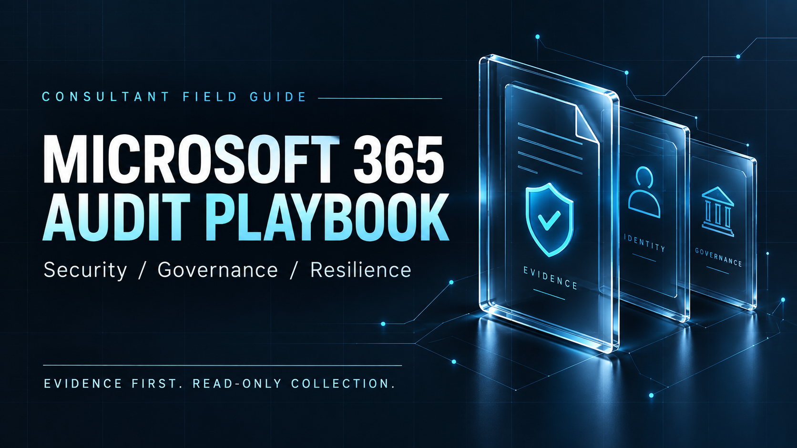

<div align="center">

# Microsoft 365 Audit Playbook

**A complete work program. A traceable source for every control. Evidence you can review.**

Plan the engagement, collect read-only evidence, challenge the findings, and deliver a defensible audit.

**[Read the playbook](PLAYBOOK.md)** &nbsp; · &nbsp; **[Run the scripts](scripts/README.md)** &nbsp; · &nbsp; **[Explore the controls](controls/CONTROL-CATALOG.md)**

<sub>Prepared for Jeff Cadet · Version 1.1 · Research reviewed 12 October 2026</sub>

</div>

---

| **90 controls** | **151 entry scripts** | **185 references** | **25 offline tests passed** |
| :---: | :---: | :---: | :---: |
| Across 17 audit domains | Controls, fieldwork and phases | Including 175 Microsoft sources | Synthetic data and mocked transports |

## Built for the whole engagement

An independent, consultant-authored toolkit for Microsoft 365 security, governance, compliance readiness, resilience and operations. It combines **10 fieldwork runbooks**, **16 engagement templates** and **100 documented read operations** with a source trail that reviewers can follow.

| Documented at the point of use | Ready for evidence collection | Explicit about assurance |
| :--- | :--- | :--- |
| Microsoft references accompany the controls, procedures and scripts. Consultant-defined criteria are identified as such. | Every entry script includes a title, short description, documentation links and an evidence contract. | Missing evidence stays visible. Configuration exports, operating evidence and final audit opinions are treated separately. |
| [Browse the sources →](references/SOURCES.md) | [Inspect script coverage →](docs/SCRIPT-COVERAGE.md) | [Read the assessment rules →](PLAYBOOK.md#7-control-assessment-rules) |

## Choose your starting point

| Your next task | Open this | What you get |
| :--- | :--- | :--- |
| **Plan an audit** | [Main playbook](PLAYBOOK.md) | Scope, responsibilities, access, sampling, risk, reporting and handoff |
| **Perform the fieldwork** | [Control catalog](controls/CONTROL-CATALOG.md) · [Runbooks](docs/FIELDWORK-RUNBOOKS.md) | Objectives, evidence, procedures, falsifying probes and assessment criteria |
| **Collect tenant evidence** | [Script guide](scripts/README.md) · [Collection guide](docs/COLLECTION-GUIDE.md) | Module setup, authentication, read operations, output files and limitations |
| **Prepare the workpapers** | [Engagement templates](templates/README.md) · [Control spreadsheet](controls/control-catalog.csv) | Charter, assessment, findings, exceptions, remediation and reporting worksheets |
| **Review the technical basis** | [Operation register](docs/SCRIPT-OPERATIONS.md) · [Source register](references/SOURCES.md) | Exact commands, API paths, permissions and direct documentation links |

## From scope to a supported conclusion

1. **Define the engagement.** Identify tenants, workloads, the review period and adopted requirements using the [charter](templates/engagement-charter.md).
2. **Prepare access and evidence.** Confirm permissions, licensing, approved targets and a controlled evidence location using the [script guide](scripts/README.md).
3. **Collect and challenge.** Execute the mapped scripts, reconcile coverage, and test the interpretation with the [fieldwork runbooks](docs/FIELDWORK-RUNBOOKS.md).
4. **Report and follow through.** Review the facts, assign owners, record limitations, and require closure evidence in the [assessment and remediation workpapers](templates/README.md).

These are the toolkit's [consultant methods](PLAYBOOK.md). Every control starts **Not assessed**.

### Preview your first control

**Title — Inspect the Conditional Access audit plan.** This example prints the planned reads, permissions, target inputs and supporting references. `-Plan` does not install modules, authenticate or query a tenant. The underlying policy operation is documented in [Microsoft's Conditional Access list API](https://learn.microsoft.com/en-us/graph/api/conditionalaccessroot-list-policies?view=graph-rest-1.0).

```powershell
# Title: Preview the Conditional Access audit plan
# Description: Inspect required reads and evidence without connecting to a tenant.
# Reference: https://learn.microsoft.com/en-us/graph/api/conditionalaccessroot-list-policies?view=graph-rest-1.0
./scripts/controls/IAM-03.ps1 -Plan | ConvertTo-Json -Depth 30
```

**When you collect evidence, the runner handles the prerequisite sequence:**

`Check modules → Install missing modules → Import → Authenticate → Verify tenant → Read`

Setup and acquisition have different effects: setup can install local modules and initiate sign-in; the audit commands collect read-only evidence. See the [execution guide](scripts/README.md#module-installation-and-authentication-sequence) and Microsoft's documentation for [module installation](https://learn.microsoft.com/en-us/powershell/module/microsoft.powershell.psresourceget/install-psresource?view=powershellget-3.x), [Graph authentication](https://learn.microsoft.com/en-us/powershell/microsoftgraph/authentication-commands?view=graph-powershell-1.0), and [Exchange connections](https://learn.microsoft.com/en-us/powershell/exchange/connect-to-exchange-online-powershell?view=exchange-ps).

## Coverage across 17 domains

| Audit area | Included domains |
| :--- | :--- |
| **Governance and access** | Governance · Entra identity and privilege · Applications and automation · Hybrid infrastructure |
| **Collaboration and devices** | Exchange · SharePoint and OneDrive · Teams · Endpoints |
| **Protection and resilience** | Information protection · Audit logging · Incident response · Recovery |
| **Platforms and operations** | Copilot and agents · Power Platform · Fabric and Power BI · Operations · Specialized tenant and workload overlays |

Explore the [90-control catalog](controls/CONTROL-CATALOG.md) for exact scope and applicability. The methodology draws on Microsoft's [Zero Trust deployment guidance](https://learn.microsoft.com/en-us/microsoft-365/security/microsoft-365-zero-trust?view=o365-worldwide), with CISA, NIST, CIS and tool-maintainer references providing additional perspectives in the [source register](references/SOURCES.md).

## Evidence behind the toolkit

| Verification | Recorded result | Inspect the evidence |
| :--- | :--- | :--- |
| Script behavior | **25 offline tests passed** using synthetic data and mocked transports | [Script verification report](research/SCRIPT-DISCONFIRMATION.md) · [Raw results](research/script-test-results.json) |
| Evidence classification | **8 synthetic cases** returned their intended classifications | [Validation results](research/validation-results.json) |
| Documentary challenges | **5 misleading shortcuts rejected** against the cited evidence | [Disconfirmation report](research/DISCONFIRMATION.md) |
| Source accessibility | **185 registered references** returned HTTP 200 during the recorded check | [Source-check results](research/source-checks.json) |

**No live tenant was audited during authoring.** These checks establish the stated documentary and offline test results; live permissions, licensing, module compatibility and control effectiveness still require validation in the engagement. A read-only script reviews existing records for interviews, approvals and active exercises, and flags missing evidence. [Script boundaries](scripts/README.md#completeness-and-remaining-work).

Completed tenant exports, credentials and client reports belong in a controlled evidence store outside this public repository. The toolkit is an independent resource, not a Microsoft publication or certification. The full CIS benchmark was not obtained; no complete CIS conformity claim is made. [Research limitations](research/DISCONFIRMATION.md).

<details>
<summary><strong>Maintainer tools · rebuild, validate and refresh references</strong></summary>

Requires Python 3.10+ for the document utilities and PowerShell 7.4+ for the audit runner. No additional Python packages are required by the repository's document utilities.

**Title — Rebuild and validate the toolkit.** Regenerates scripts, source navigation and workpapers, then runs local checks. Script help follows [Microsoft's comment-based help format](https://learn.microsoft.com/en-us/powershell/module/microsoft.powershell.core/about/about_comment_based_help).

```powershell
# Title: Rebuild the documented audit toolkit
# Description: Regenerate documentation and scripts, then run local validation.
# Reference: https://learn.microsoft.com/en-us/powershell/module/microsoft.powershell.core/about/about_comment_based_help
python tools/build_scripts.py
python tools/build.py
python tools/integrate_script_docs.py
python tools/validate.py
pwsh -NoProfile -File tests/Test-ReadOnly.ps1
```

**Title — Recheck documentation sources.** Fetches referenced pages and records status, hashes and targeted checks without connecting to a tenant. The API references are part of [Microsoft Graph documentation](https://learn.microsoft.com/en-us/graph/overview).

```powershell
# Title: Verify reference accessibility
# Description: Check cited source pages and documented API or command paths.
# Reference: https://learn.microsoft.com/en-us/graph/overview
python tools/check_sources.py
python tools/check_script_sources.py
```

Revisit licensing, cloud availability, preview features and retirement dates before each engagement. Source accessibility is recorded evidence, not a guarantee that a service or permission remains unchanged.

</details>

---

<div align="center">

**Start with the requirement. Follow the evidence. Make the limitations visible.**

[Playbook](PLAYBOOK.md) · [Scripts](scripts/README.md) · [Templates](templates/README.md) · [Sources](references/SOURCES.md)

<sub>Independent methodology · Original thumbnail generated for this repository · <a href="assets/README.md">Artwork details</a></sub>

</div>
